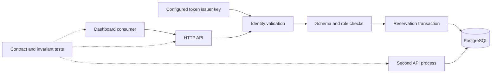

# Quality strategy for reservation correctness

The important outcome is a reservation that stays correct under competing writers, denied access and an uncertain response. A green UI flow alone cannot establish that. This strategy describes the implemented local lab and the evidence still needed before adapting it to a deployed service.

## Risks and where to test them

| Risk | Test boundary | Required observation |
| --- | --- | --- |
| A tenant reads another tenant's record | Signed identity and HTTP read | Foreign and unknown IDs return the same 404 |
| A viewer writes or a malformed identity is accepted | HTTP authorization | Denied status; unchanged persisted state |
| Two writers oversell inventory | Two API processes and native PostgreSQL | Stock/reservation invariants hold after both requests settle |
| A committed response is lost | Persisted idempotency key and intent | Same key/intent recovers one result; changed intent conflicts |
| Count and page observe different writes | Database read snapshot | One response represents one snapshot |
| A migration fails or applied history drifts | Startup transaction and ledger | Startup rejects drift; failed SQL leaves no partial ledger/schema |
| Provider change breaks a consumer | Actual dashboard client and generated Pact | Incompatible field changes fail; unrelated additions remain compatible |
| A partial run appears successful | Workflow exit status and reports | Required checks succeed on the revision being reviewed |

The executable entry point is `npm run verify`. Unit tests cover local state and migration behavior; HTTP tests exercise authorization and persistence; native PostgreSQL tests exercise independent service processes; consumer tests verify the dashboard contract. Browser behavior belongs in the separate Playwright project, where UI changes can be checked against API read-back.

## Data, environments and ownership

Each database test owns its temporary database, generated credentials and service processes. Teardown closes processes and removes the temporary database. Fixtures are synthetic; production accounts and shared databases are unnecessary. PGlite gives a convenient interactive default, while PostgreSQL tests cover the coordination boundary that an embedded single-process store cannot establish.

The service owns authorization, transactions and replay semantics. The consumer owns its field assumptions. A reviewer should inspect both sides before changing a contract. In a team, an API owner would approve behavioral/schema changes and affected consumers would verify compatibility; this lab does not claim that organizational adoption has occurred.

## Change and release decisions

Require source checks and the full verification command on the proposed revision. Inspect failed requests and persisted state before retrying anything. Keep the signature/claim-shape, tenant-boundary, competing-writer and migration negative controls when refactoring. A passed contract test covers the declared inventory interaction, not every endpoint.

Review reports alongside the commit and workflow result. An old passing artifact or a missing native-database stage cannot substitute for current evidence. Hosted checks and local observations are linked separately in the [verification record](verification.md).

## Performance and operations

The [read baseline](verification.md#read-workload-baseline) measures 200 reads after warm-up at concurrency four on one host. It is diagnostic, not a production throughput claim. Before selecting thresholds, define the deployed workload, data volume, client network, expected traffic and resource budget. Then measure sustained load, write contention, latency percentiles, errors and database saturation against that budget.

Operational evidence still needed includes correlated request/transaction logs without tokens, replay/conflict counters, database lock/connection observations, process-crash recovery and reconciliation after a network failure. These are next validation steps, not delivered monitoring features. Orderly restart tests do not establish crash durability.

## Design trade-offs

- Keyed replay avoids treating an uncertain response as a new intent, but callers must preserve the key and payload.
- Database coordination works across the two tested service processes; it does not demonstrate a multi-region deployment.
- Snapshot reads protect one response's consistency, with transaction overhead that needs measurement under a representative workload.
- A real small consumer contract is more useful than claiming universal compatibility from a schema alone.

Follow the [failure walkthrough](walkthrough.md) for concrete tests and the [design decisions](decisions/) for implementation details. This strategy records local architectural reasoning; it is not evidence of production ownership or cross-team leadership.
